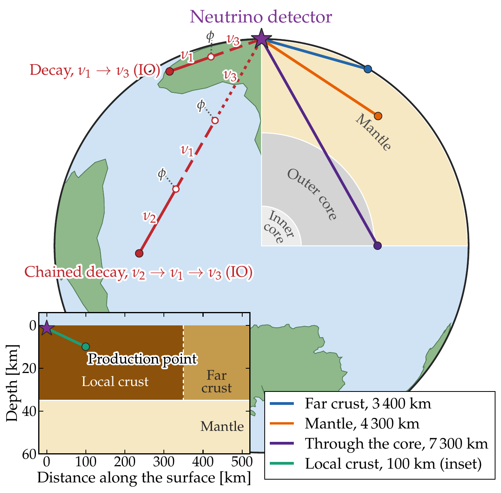

# Geoneutrinos (and reactor neutrinos) do not visibly decay

Data and code for the paper *Geoneutrinos (and reactor neutrinos) do not visibly decay*, by Mauricio
Bustamante. arXiv: [2611.23978](https://arxiv.org/abs/2611.23978).

<p align="center">
  
</p>

*Where geoneutrinos come from (Fig. 5 of the paper): a cut through the Earth, with the detector at Gran Sasso, the site of Borexino.*

Neutrinos that decay on their way to a detector arrive depleted, more so at low energies.
Geoneutrinos, the electron antineutrinos from the radioactive decay of uranium and thorium inside the
Earth, have energies of a few MeV and travel up to the diameter of the Earth, which makes them
sensitive to neutrino lifetimes of $\tau/m \sim 10^{-8}$ s eV<sup>-1</sup>. The paper tests visible
neutrino decay, in which the daughter neutrinos are themselves detected, with the geoneutrino and
reactor-antineutrino data of Borexino, KamLAND, SNO+, and JUNO. Combining the four experiments, it limits
the decay $\nu_1 \to \nu_3$ in the inverted mass ordering at 90% C.L.: $\tau_1/m_1 > 3.7 \times 10^{-9}$
s eV<sup>-1</sup> when the radiogenic power of the Earth is left free, and
$\tau_1/m_1 > 4.4 \times 10^{-9}$ to $1.6 \times 10^{-8}$ s eV<sup>-1</sup> when it is taken from Earth
models. It sets limits on every other channel it considers too.

This repository holds every limit of the paper, in one file, and the numbers and code that redraw every
figure of the paper.

## How to use it

* **The limits:** `data/limits.json`; see [The limits](#the-limits) below.
* **The figures:** `figures/`, as PDF files, and `notebooks/figures.ipynb`, which redraws each one
  from `data/` and explains it. GitHub shows the notebook with its figures, without running it.

## The repository

```
README.md            this file
LICENSE              MIT for the code; CC BY 4.0 for data/ and figures/
requirements.txt     what the notebook needs
make_figures.py      runs the notebook in place: python make_figures.py
data/
  limits.json        every limit of the paper
  <figure>.json      the numbers of each figure (see Data below)
figures/             every figure of the paper, as PDF; Fig. 5 also as PNG, for this page
notebooks/
  figures.ipynb      redraws every figure from data/
plotting/
  data.py            reads data/
  style.py           the paper's figure style (matplotlibrc)
  helpers.py, ...    the paper's plotting code
```

## The limits

`data/limits.json` holds every lower limit on the lifetime-to-mass ratio, $\tau_i/m_i$, that the paper
reports, in s/eV, under the key `lower_limit_s_per_eV`, nested as

```
[channel][lifetime][fit][Earth model][C.L.][observed | expected]
```

* **channel:** the decay channel (below). A chain, in which the daughter of the first decay decays in
  turn, limits the lifetimes of both of its parents.
* **lifetime:** `tau1_over_m1`, `tau2_over_m2` or `tau3_over_m3`.
* **fit:** `borexino`, `kamland`, `snoplus`, `juno`, `combined_bx_kl_snoplus` (Borexino, KamLAND, and
  SNO+ combined), or `combined_all` (all four combined).
* **Earth model:** `cosmochemical`, `geochemical` or `geodynamical`, the three classes of
  bulk-silicate-Earth model, each with its radiogenic power, or `free_radiogenic_power`, the power left
  free between 9.4 and 39.6 TW.
* **C.L.:** `"90"` or `"95"`, for a one-sided lower limit.
* **observed** is the limit from the experiments' data; **expected** is the limit from the Asimov data
  set, in which every bin holds its expected number of events without decay.

A value is `null` where that fit sets no limit. The file's `how_to_read` field explains every key, and
its `channels`, `fits` and `earth_models` fields describe each value they take.

| Channel in the file | Decay | Mass ordering | Lifetimes limited |
|---|---|---|---|
| `io_n1_n3` | $\nu_1 \to \nu_3$ | inverted | `tau1_over_m1` |
| `io_n2_n3` | $\nu_2 \to \nu_3$ | inverted | `tau2_over_m2` |
| `io_n2_n1` | $\nu_2 \to \nu_1$ | inverted | `tau2_over_m2` |
| `io_n2_n1_n3` | $\nu_2 \to \nu_1 \to \nu_3$ | inverted | `tau2_over_m2`, `tau1_over_m1` |
| `no_n2_n1` | $\nu_2 \to \nu_1$ | normal | `tau2_over_m2` |
| `no_n3_n1` | $\nu_3 \to \nu_1$ | normal | `tau3_over_m3` |
| `no_n3_n2` | $\nu_3 \to \nu_2$ | normal | `tau3_over_m3` |
| `no_n3_n2_n1` | $\nu_3 \to \nu_2 \to \nu_1$ | normal | `tau3_over_m3`, `tau2_over_m2` |

The four experiments combined set a 90% C.L. limit on every lifetime of every channel, on every Earth
model. Some single experiments set none on some channels; the limits on $\tau_3/m_3$ come from JUNO.

With Python's standard library only:

```python
import json

limits = json.load(open("data/limits.json"))["lower_limit_s_per_eV"]
print(limits["io_n1_n3"]["tau1_over_m1"]["combined_all"]["free_radiogenic_power"]["90"]["observed"])
```

With the repository's reader:

```python
from plotting import data

data.limit("io_n1_n3", "tau1_over_m1", "combined_all", "free_radiogenic_power", cl="90", kind="observed")
```

## Redrawing the figures

```
pip install -r requirements.txt
python make_figures.py
```

or open `notebooks/figures.ipynb` and run every cell. The figures set their text with LaTeX in
Palatino, as in the paper, so a LaTeX installation with the psnfss fonts and the amssymb package is
needed too. The notebook reads only `data/`; it needs none of the paper's analysis code.

## Figures

| Figure in the paper | File | Data |
|---|---|---|
| 1: Lower limits on the neutrino lifetime-to-mass ratio, $\tau_i/m_i$, from visible decay | `figures/money_plot.pdf` | `data/money_plot.json` |
| 2: Survival probability of geoneutrinos against the distance they travel, without decay and with $\nu_1 \to \nu_3$ in the inverted mass ordering | `figures/survival_vs_distance.pdf` | `data/survival_vs_distance.json` |
| 3: Flavor content of the three neutrino mass eigenstates allowed by NuFIT 6.1 | `figures/flavor_content.pdf` | `data/flavor_content.json` |
| 4: Antineutrino spectra of the uranium and thorium decay chains above the threshold of inverse beta decay, nuclide by nuclide | `figures/chain_spectra.pdf` | `data/chain_spectra.json` |
| 5: Where geoneutrinos come from: a cut through the Earth, with the detector at Gran Sasso, the site of Borexino | `figures/geoneutrino_schematic.pdf` | `data/geoneutrino_schematic.json` |
| 6: Geoneutrino flux at Borexino, with and without decay | `figures/neutrino_spectrum.pdf` | `data/neutrino_spectrum.json` |
| 7: Geoneutrino flux at Borexino by the distance it travels, reservoir by reservoir, with and without decay | `figures/flux_by_distance.pdf` | `data/flux_by_distance.json` |
| 8: Reactor antineutrinos with and without decay: the flux at SNO+, core by core, and the fraction of the reactor antineutrinos at each experiment that survives decay | `figures/reactor_decay.pdf` | `data/reactor_decay.json` |
| 9: JUNO's reactor antineutrinos with and without the decay of $\nu_3$, which flattens the ripple of the oscillation driven by $\Delta m^2_{31}$ | `figures/juno_nu3_decay.pdf` | `data/juno_nu3_decay.json` |
| 10: Detected spectra of the four experiments, with and without decay, against their data | `figures/event_spectra.pdf` | `data/event_spectra.json` |
| 11: Lower limits on $\tau_i/m_i$ from every decay channel, experiment, and Earth model | `figures/limits_overview.pdf` | `data/limits_overview.json` |
| B.1: Our calculation of each experiment's detected spectrum without decay, compared with the collaboration's best fit | `figures/reproduction.pdf` | `data/reproduction.json` |
| B.2: Response function of each data set | `figures/detector_response.pdf` | `data/detector_response.json` |
| B.3: Reactor antineutrinos in each data set, reactor by reactor, with and without decay | `figures/reactor_spectra.pdf` | `data/reactor_spectra.json.gz` |
| B.4: How far reactor antineutrinos and geoneutrinos travel to each data set | `figures/reactor_flux_by_distance.pdf` | `data/reactor_flux_by_distance.json` |
| C.1: Lower limits from data compared with those of simulated experiments without decay | `figures/brazil.pdf` | `data/brazil.json` |
| D.1: Coverage of the 90% C.L. limits, tested with simulated experiments with decay | `figures/coverage.pdf` | `data/coverage.json` |
| E.1: Fitted values of the parameters of the four experiments combined, with the radiogenic power free, and how much each moves the limit | `figures/impacts.pdf` | `data/impacts.json` |
| E.2: How much each parameter moves the limit of each experiment | `figures/impacts_experiments.pdf` | `data/impacts_experiments.json` |
| E.3: How the lifetime trades off against the parameters that move most with it, fit by fit | `figures/corner_rows.pdf` | `data/corner_rows.json` |
| G.1: The constraint on the solar mixing parameters that our fits use | `figures/nufit_constraints.pdf` | `data/nufit_constraints.json` |

## Data

Each figure's file holds the results of the functions that the paper's code calls to draw it, each with
the arguments it was called with, so that the notebook redraws the figure with the paper's own plotting
code. Where JSON has no type for a Python object: an array is a list (`null` for a value that is not a
number), and a dictionary keyed by something other than strings, such as one keyed by lifetimes, is
`{"__keys__": [...], "__values__": [...]}`; a tuple is `{"__tuple__": [...]}`; an object that JSON cannot
hold, such as a detector's description, is a name like `"<object 1>"`, the same wherever the object
recurs. `plotting/data.py` reads them back.

The limits are rounded to six significant digits; a figure's numbers to ten. Three files are reduced
where the figure shows less detail than they would hold: the spectra of the individual reactor cores
(`reactor_decay.json`, `reactor_spectra.json.gz`) are kept at every fourth energy, a step of 10 keV, and
each detector response (`detector_response.json`) has its values below 1e-4 of its largest set to zero;
these three keep six digits. The two figures of reactor cores therefore differ from the paper's by a
fraction of a pixel along their lines. Files larger than 10 MB are gzip-compressed (`.json.gz`), and
`plotting/data.py` reads them as they are.

## Sources

* Borexino: *Comprehensive geoneutrino analysis with Borexino*, Phys. Rev. D **101**, 012009 (2020),
  arXiv:1909.02257.
* KamLAND: *Abundances of uranium and thorium elements in Earth estimated by geoneutrino spectroscopy*,
  Geophys. Res. Lett. **49**, e2022GL099566 (2022), arXiv:2205.14934.
* SNO+: *Measurement of Reactor Antineutrino Oscillations with 1.46 Kilotonne-Years of Data at SNO+*,
  Phys. Rev. Lett. **137**, 101807 (2026), arXiv:2511.11856.
* JUNO: *Measurement of Neutrino Oscillation Parameters at JUNO and Indication of the Neutrino Mass
  Ordering*, arXiv:2609.37895 (2026).
* Neutrino mixing parameters: NuFIT 6.1, www.nu-fit.org; I. Esteban et al., JHEP **12** (2024) 216,
  arXiv:2410.05380.
* Earth's density: A. M. Dziewonski and D. L. Anderson, Phys. Earth Planet. Interiors **25**, 297 (1981).
* Land outlines (Fig. 5): Natural Earth, 1:110m, public domain.
* The published limits in Fig. 1: listed with their sources in `plotting/money.py` (`CITATIONS`) and in
  the paper.

## How to cite

If you use these data or this code, please cite the paper:

M. Bustamante, *Geoneutrinos (and reactor neutrinos) do not visibly decay*, arXiv:2611.23978 [hep-ph] (2026).

```bibtex
@article{Bustamante:2611.23978,
    author = "Bustamante, Mauricio",
    title = "{Geoneutrinos (and reactor neutrinos) do not visibly decay}",
    eprint = "2611.23978",
    archivePrefix = "arXiv",
    primaryClass = "hep-ph",
    year = "2026"
}
```

## License

The code is MIT-licensed; the data and the figures are CC BY 4.0. See `LICENSE`.
